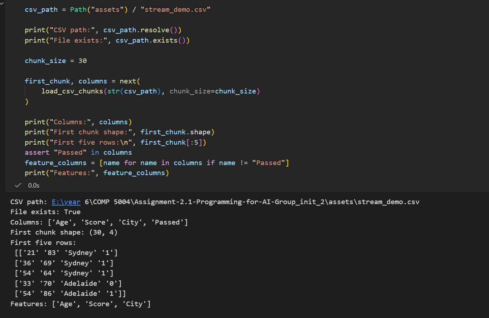
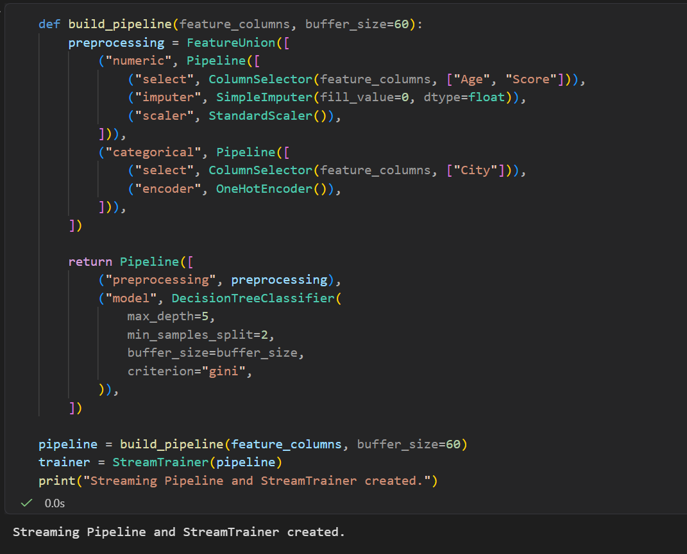
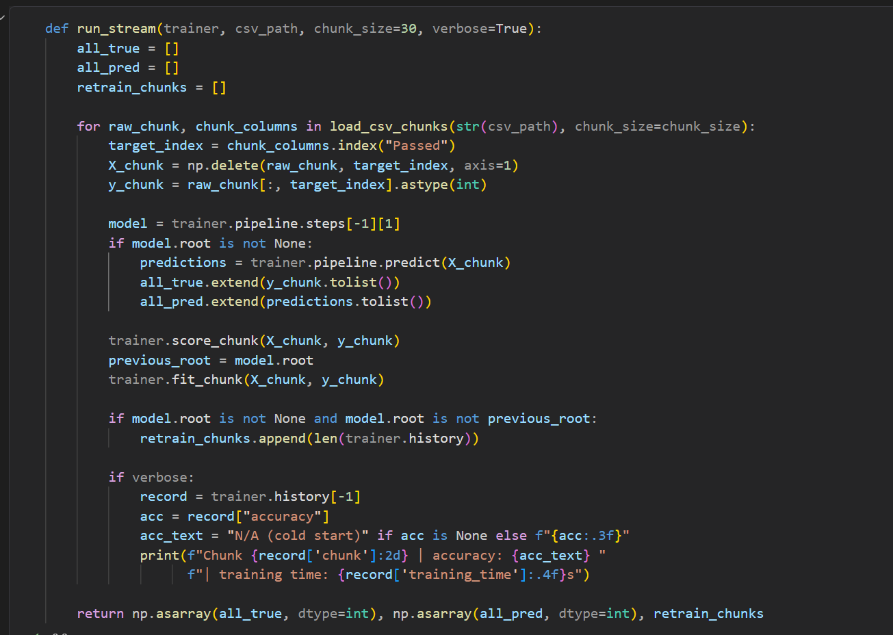
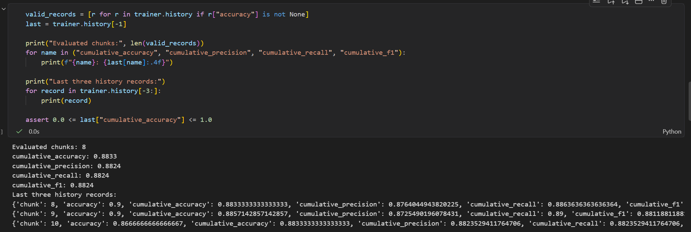
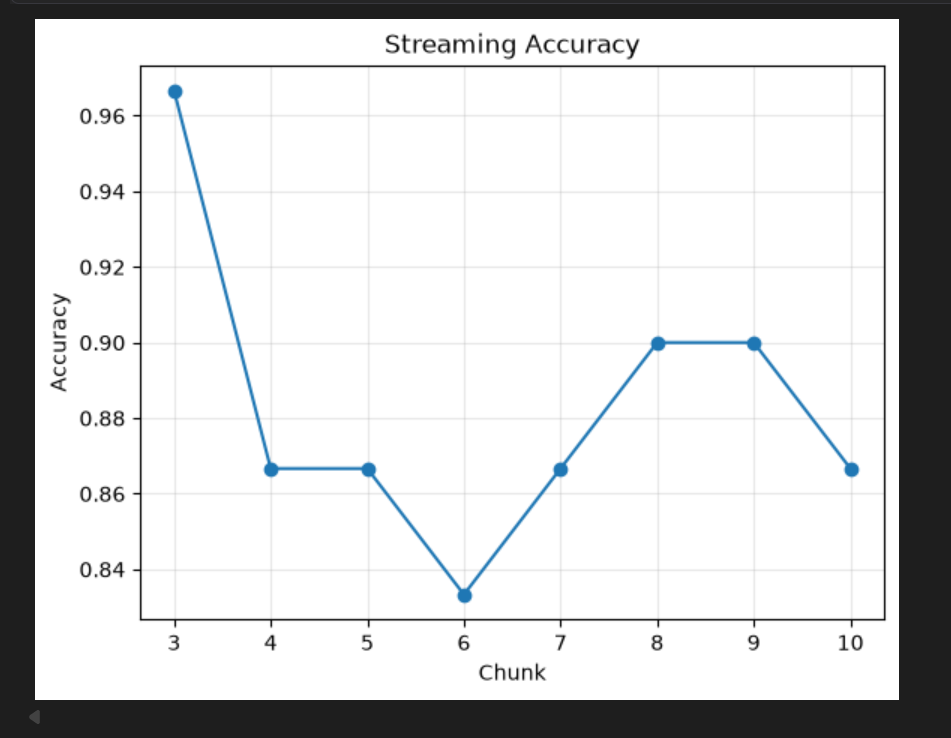
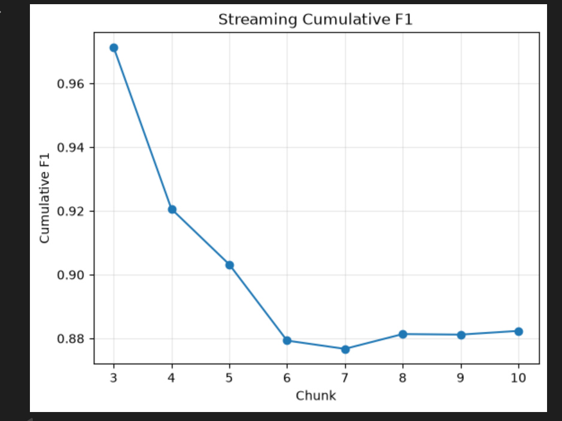
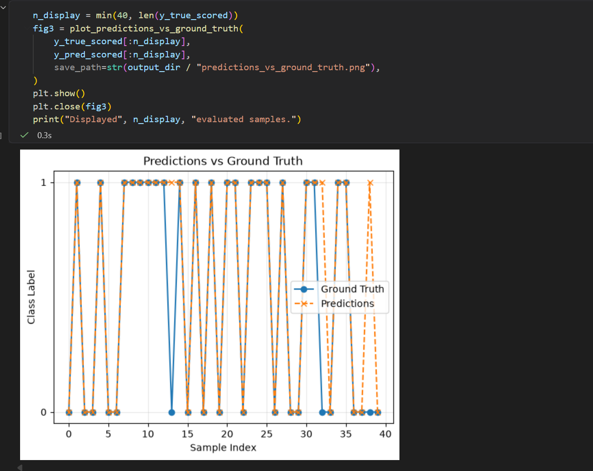
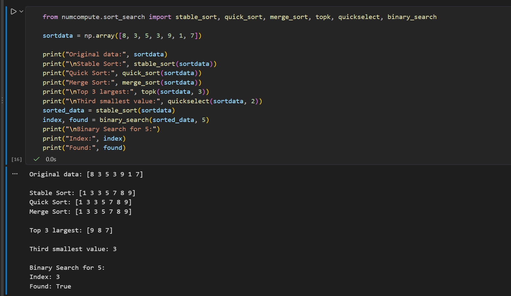
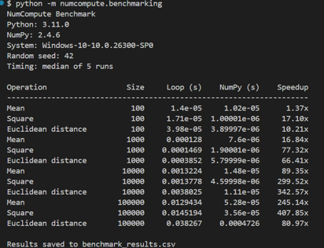

# Assignment-2.2-Programming-for-AI-Sijie Jack Fan-a3236464

# NumCompute_Stream

NumCompute-Stream builds on our NumCompute toolkit from Assignment 2.1. The original package provided functions for CSV loading, preprocessing, statistics, metrics, and pipelines. In this assignment, we have added streaming support so that data can be processed in smaller chunks, instead of loading everything and training the model at once. The project uses Python, NumPy, and Matplotlib.

The main additions are incremental preprocessing, a Decision Tree with buffered retraining, streaming classification metrics, and visualisation functions. The examples below follow `demo/stream_demo.ipynb`, which shows how these modules can be used together. The example dataset is synthetic and is only used to demonstrate the package.

## Main Workflow

The normal streaming workflow is:

1. Read the CSV using `load_csv_chunks()`.
2. Create numerical and categorical preprocessing branches with `Pipeline` and `FeatureUnion`.
3. Add a `DecisionTreeClassifier` as the last step of the pipeline.
4. Create a `StreamTrainer` to evaluate and train on each chunk.
5. Read the recorded accuracy, classification metrics, time, and memory information.
6. Use `visualise.py` to plot the results and compare different buffer sizes.

### Step 1: Load the CSV file
The `io.py` module provides `load_csv()` and `load_csv_chunks()`, as in Assignment 2.1. Here we use `load_csv_chunks()` because it reads the data in smaller pieces. Each call returns a two-dimensional NumPy string array and the CSV column names.

The demo file contains 300 rows with `Age`, `Score`, and `City` as input features, and `Passed` as the binary target (0 or 1). We use 30 rows per chunk, so the file is processed in 10 chunks.

The CSV values are initially stored as strings. The numeric columns are converted later in the preprocessing pipeline.

### Step 2: Create the Preprocessing and Model Pipeline

Similar to Assignment 2.1, numerical and categorical data are handled in separate branches. `ColumnSelector` selects the columns for each branch. `SimpleImputer` fills missing numerical values with 0, `StandardScaler` scales the numerical data, and `OneHotEncoder` converts `City` into numerical features.

`FeatureUnion` combines these branches into one feature array. This time, the pipeline also includes our own `DecisionTreeClassifier` at the end. It uses `buffer_size` to decide when the buffered data is large enough to retrain the tree.

In the demo, this structure is put inside `build_pipeline()` so that users can easily create a new pipeline with a different buffer size. During streaming updates, the pipeline also keeps a preprocessing snapshot for the active tree. This means a change in the scaler or a new category does not immediately change the inputs used by an older tree.

### Step 3: Set Up Streaming Evaluation

The `stream.py` module provides `StreamTrainer`, which connects the pipeline with the streaming metrics. Users can call `score_chunk()` to evaluate the current chunk and `fit_chunk()` to update the model.

For the demo, we use test-then-train: each chunk is evaluated with the existing model before it is used for training. This avoids testing a model on the same chunk it has just learned from.

The notebook's `run_stream()` helper reads the chunks from the CSV and performs these calls in order. It also saves predictions for a later comparison with the actual labels. During *cold start*, before the first tree has been trained, the accuracy is recorded as `None` rather than 0.

### Step 4: Run the Streaming Experiment

The first experiment uses `chunk_size=30` and `buffer_size=60`. After the first two chunks, the buffer has received 60 samples and the tree can be trained for the first time. Predictions start from the third chunk. Once another 60 samples have been collected, the tree is retrained using the new buffered data.

For this 300-row example, the demo processes 10 chunks. With a buffer size of 60, the first two chunks are used for cold start, so 240 samples are evaluated. The model retrains after chunks 2, 4, 6, 8, and 10.

### Step 5: Check the Streaming Metrics

In `metrics.py`, `StreamingClassificationMetrics` supports binary classification with labels 0 and 1. Its `update()` method accumulates the confusion matrix, and `result()` returns the current Accuracy, Precision, Recall, and F1. `reset()` clears the accumulated data. It also supports rolling-window metrics over the most recent chunks.

`StreamTrainer` uses these metrics and saves the results in `trainer.history`. Users can read the history to see how the model performed over time, rather than only checking one final accuracy value.

Training time covers the preprocessing and training call for that chunk. The recorded peak memory is measured with Python's `tracemalloc`; it is not the total memory used by the process. As memory tracking adds overhead, these timings should not be treated as controlled benchmark results.

### Step 6: Plot Metrics over Time

In this package, `visualise.py` provides `plot_metric_over_time()` for plotting a selected metric from the history. In the demo, we use it to plot per-chunk Accuracy and cumulative F1. The cold-start entries are missing values, so they are not shown as accuracy 0.

The notebook also creates `demo/outputs/cumulative_f1.png`. The output folder is created automatically if it does not already exist.

### Step 7: Compare Predictions with Ground Truth

Another way to check the classifier is to compare its predictions with the actual labels. `plot_predictions_vs_ground_truth()` takes two arrays: the true labels and the predicted labels. The demo uses the first 40 evaluated samples to keep the plot readable. Samples from cold start are not included, because the model did not make predictions for them.

### Step 8: Compare Different Buffer Sizes

Users can also create a second pipeline with a different `buffer_size` and run the same dataset through it. The demo compares buffer sizes of 60 and 120 using `compare_models()` to plot their cumulative Accuracy.

For this example, buffer 60 retrains after chunks 2, 4, 6, 8, and 10, while buffer 120 retrains after chunks 4 and 8. The comparison shows how buffer size changes the training schedule and the metrics. It is a demonstration of the configuration, not yet a controlled performance benchmark.

## Input and Output Notes

- `load_csv_chunks()` returns the column names and a 2D string array for each chunk. Select the target column and convert its labels to integers before training.
- The example uses binary targets, `0` and `1`. The streaming classification metrics in the current implementation use these two labels.
- The numeric branch fills missing `Age` and `Score` entries with `0` before scaling. This is the demo's choice; users may select different fill values for their data.
- Users specify numerical and categorical columns with `ColumnSelector`; the pipeline does not identify them automatically.
- Use `Pipeline.partial_fit()` for streaming updates. The normal `fit()` and `fit_transform()` methods remain available for batch processing.
- The buffered tree uses its most recently trained model between retraining events. Predictions are unavailable until the first buffer has been trained.
- The pipeline stores a matching preprocessing snapshot for its active model, including when new categories change the encoded feature count.
- Plots created by the notebook are saved to `demo/outputs/`.

## Other Modules

Besides the modules shown in the main demo, the package still includes the numerical utilities from Assignment 2.1, such as sorting, searching, ranking, optimisation, and batch statistics.

### Streaming Statistics

`StreamingStats` in `stats.py` can update statistical information as new numerical chunks arrive. It supports running mean and variance, as well as histogram and quantile operations. The incremental scalers also make use of running statistics.

### Incremental Preprocessing

`preprocessing.py` contains `StandardScaler`, `MinMaxScaler`, `SimpleImputer`, `OneHotEncoder`, and `ColumnSelector`. The streaming versions use `partial_fit()` to update their learned state while retaining the regular batch API.

### Decision Tree and Metrics

`tree.py` provides `DecisionTreeClassifier` with Gini or Entropy splitting, depth and sample limits, optional feature selection, and buffered retraining. `metrics.py` provides the binary streaming metrics, cumulative confusion matrix, and rolling-window calculations used by `StreamTrainer`.

### Sorting and Searching

`sort_search.py` provides several sorting and searching functions, including `stable_sort()`, `quick_sort()`, `merge_sort()`, `topk()`, `top_p()`, `quickselect()`, and `binary_search()`.

Users can sort numerical arrays, find the largest or smallest values, or search for an element in sorted data. `quickselect()` uses a zero-based index, and `binary_search()` requires the input array to be sorted.

## Performance Comparisons

The package uses a benchmarking script to compare Python loops with NumPy operations for calculating a mean, squaring array elements and calculating Euclidean distance. The tests used input sizes of 100, 1,000, 10,000 and 100,000 elements, with the median of five runs used for timing.

The results showed that NumPy was faster than Python loops in all tested cases. For 100,000 elements, the results were:

These results show the performance benefits of NumPy vectorisation for the selected operations.

To reproduce the benchmark results, run:

python -m numcompute.benchmarking

The results will also be saved in benchmark_results.csv.

