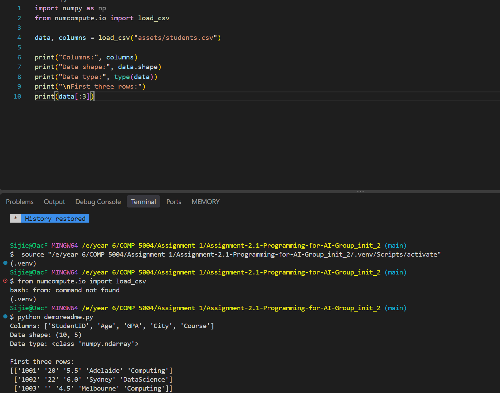
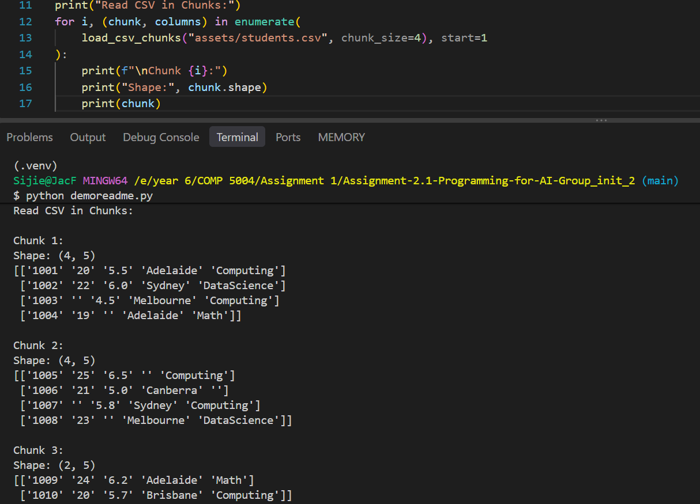
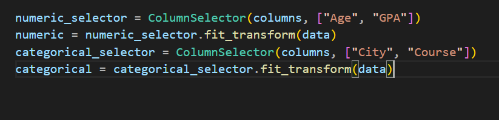
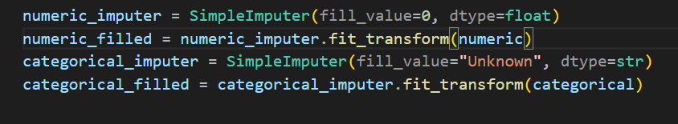
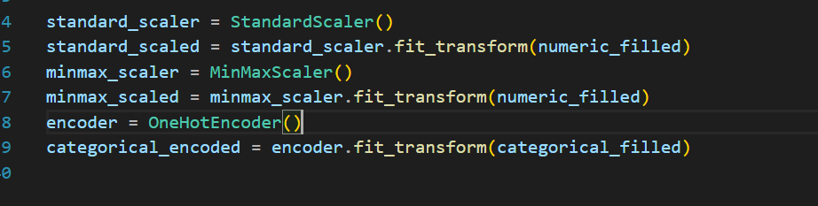
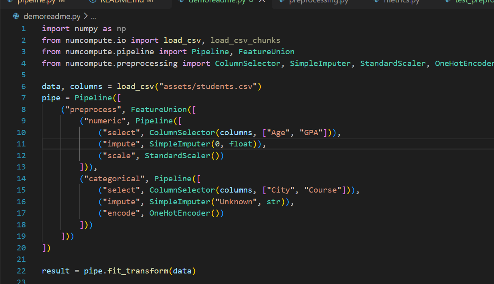
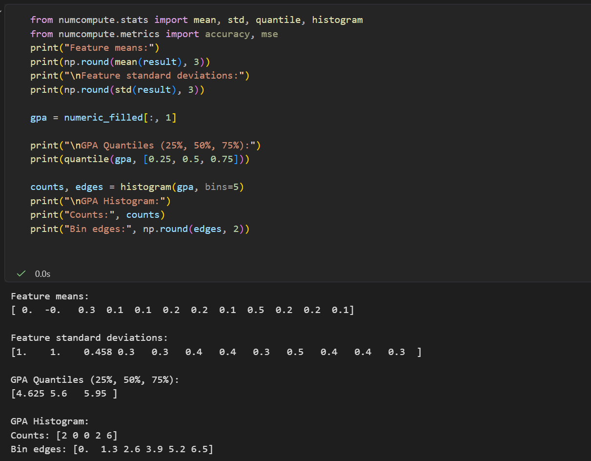
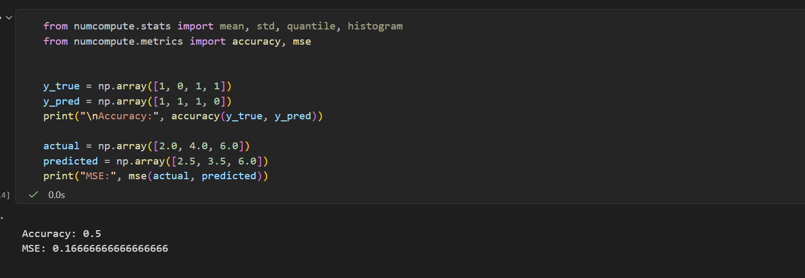
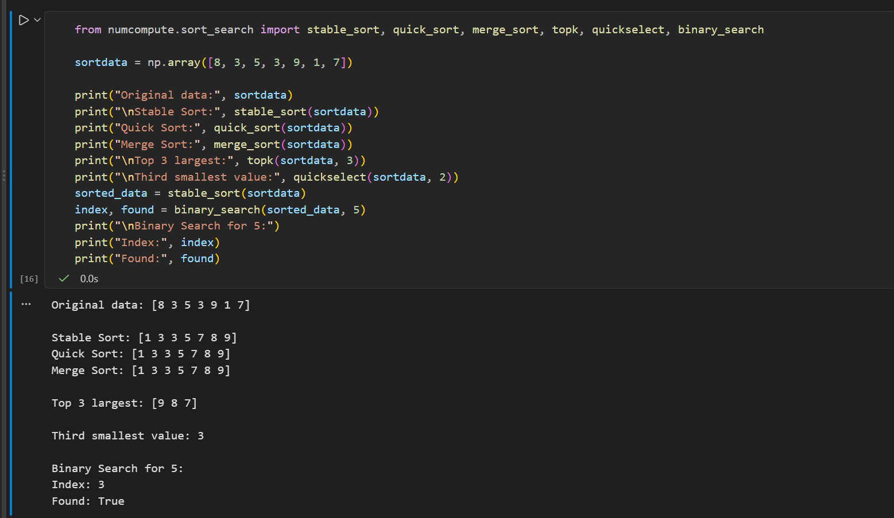

# Assignment-2.1-Programming-for-AI-Group_init_2

## Group Formation
a3236464 Sijie Fan

Santrupth Shivanna

# NumCompute

NumCompute is a Python toolkit for working with numerical data using NumPy. It includes CSV loading, preprocessing, pipeline composition, statistics, metrics, sorting and searching, ranking, numerical optimisation, and other utility functions.

## Main Workflow

The normal workflow is:

1. Load a CSV file with `io.py`.
2. Select numerical and categorical columns with `ColumnSelector`.
3. Fill missing values with `SimpleImputer`.
4. Scale numerical columns and one-hot encode categorical columns.
5. Use `FeatureUnion` to combine the processed columns.
6. Optionally pass the features to a user-provided estimator through `Pipeline`.
7. Use the other modules for statistics, evaluation, and numerical analysis as needed.

### Step 1: Load the CSV file
In the package, there are two csv read functions provided: load_csv and load_csv_chunks:

`load_csv` returns `(data, columns)`. `data` is a 2D NumPy string array, and `columns` contains the CSV header names. Numeric values are initially kept as strings because a regular NumPy array has one data type; they are converted in the numeric preprocessing branch.

`load_csv_chunks` return the same thing as load_csv, however, it reads data in chunks rather than reading the whole thing at once. This is typically better for larger data, since it can save memory usage.

### Step 2 - 5: Create the preprocessing pipeline

Now with the CSV file loaded, the data can be passed to the pipeline for processing, but users can also choose the manully run the transformers step by step. In here, the step by step way will be demonstrated first, then the full pipeline. For this package, numerical and categorical data will be processed in separate branches of the pipeline, and combined with FeatureUnion. Users will need to specify which columns they want to be processed as numerical, and which columns they want to be processed as categorical, using the ColumnSelector transformer:

Next, data will be passed to the SimpleImputer. This is for filling the missing values in the data, and converting data to the correct types. Users need to specify the type of the data (float or str), and can specify what placeholder they want to use for replace missing:

Then, users can apply numeric scaling and encoding to the data. This package supports two types of scalers and one encoder: StandScaler and MinMaxScaler for numerical data, and OneHotEncoder for categorical data. For MinMaxScaler, user can also specify the range they want to scale to. 

Users may also do the processing together using a pipeline, with the numerical and categorical pipelines combined using FeatureUnion. A full pipeline is shown as below: 

### Step 6 (optional): Add a predictor

In this package, there is no predictor provided. However, the pipeline supports predictor APIs, and users may add a predictor on their own. To do so, they can add a predictor at the last step of the pipeline, and pipeline will run the fit() and predict() functions from predictor. The predictor has to contain these functions and be placed at the last step of the pipeline to work. 

## Input and Output Notes

- The preprocessing examples expect a 2D NumPy array.
- `load_csv()` preserves CSV values as strings; the numerical `SimpleImputer` branch converts selected values to `float`.
- Missing numeric entries can be filled with `0`; missing categorical entries can be filled with `"Unknown"`. These are example choices, not required values for all datasets.
- You must choose the numeric and categorical columns explicitly. The pipeline does not automatically identify feature types.
- The column names and order for new data must match those used when fitting `ColumnSelector`.
- `Pipeline` allows transformers in intermediate steps. A predictor, when used, belongs in the last step.

## Other Modules

Besides data preprocessing, NumCompute also provides functions for statistics, evaluation, sorting and searching. These functions can be used independently with NumPy arrays.

### Statistics

`stats.py` provides functions for calculating basic statistics, including `mean()`, `median()`, `std()`, `minimum()`, `maximum()`, `quantile()`, and `histogram()`.

Users can pass numerical arrays to these functions to calculate statistics. `quantile()` calculates values at specified quantiles, while `histogram()` returns the counts and bin edges for a given number of bins.

### Metrics

`metrics.py` provides functions for evaluating prediction results, including `accuracy()`, `precision()`, `recall()`, `f1()`, `confusion_matrix()`, and `mse()`.

Users provide the actual values (`y_true`) and predicted values (`y_pred`) to calculate evaluation metrics. The classification metrics use binary labels (0 and 1), while MSE is used for numerical predictions.

### Sorting and Searching

`sort_search.py` provides several sorting and searching functions, including `stable_sort()`, `quick_sort()`, `merge_sort()`, `topk()`, `top_p()`, `quickselect()`, and `binary_search()`.

Users can sort numerical arrays, find the largest or smallest values, or search for an element in sorted data. `quickselect()` uses a zero-based index, and `binary_search()` requires the input array to be sorted.

## Performance Comparisons

